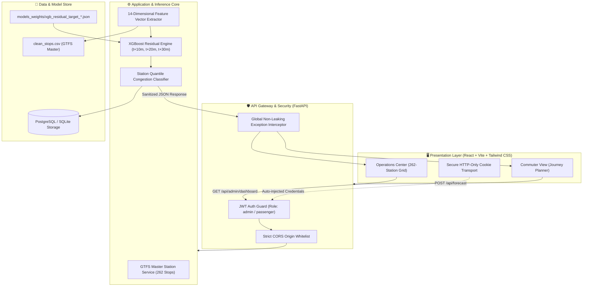

# 🚇 MetroAI — Predictive Crowd Analytics & Passenger Flow Forecasting

[](https://react.dev/)
[-009688?logo=fastapi&logoColor=white&style=for-the-badge)](https://fastapi.tiangolo.com/)
[](https://xgboost.readthedocs.io/)
[](https://www.postgresql.org/)
[](https://vercel.com/)
[](https://render.com/)

> **Next-generation passenger inflow forecasting system for the Delhi Metro Rail Corporation (DMRC) network.**  
> Anticipate entrance turnstile bottlenecks, balance transit corridors, and guide commuter departure timing across all 262 Delhi Metro stations.

---

## 🏗️ Architecture & Dataflow Pipeline

The following flowchart illustrates the end-to-end dataflow from user interaction down to XGBoost residual boosting and transactional persistence.



---

## 🛑 The Problem: Delhi Metro Congestion

The Delhi Metro is the backbone of the National Capital Region, ferrying over **6 million passenger journeys daily**. During peak rush hours (08:30–10:30 and 17:30–20:00), critical interchange hubs such as **Rajiv Chowk**, **Kashmere Gate**, and **Hauz Khas** experience extreme pedestrian bottlenecks at:
1. **Entry Turnstiles (AFC Gates)**: Ingress queues spilling onto concourses.
2. **Security Screening**: Uneven queue density across multiple station gates.
3. **Reactive Crowd Control**: Station managers only deploy marshals *after* over-saturation occurs.

---

## 💡 The Solution: Synthetic GTFS Profiles + Residual XGBoost

Traditional crowd monitoring relies on reactive cameras or post-hoc AFC log audits. **MetroAI** predicts future passenger inflow rates **10, 20, and 30 minutes in advance**.

### Mathematical Formulation
Passenger inflow rate is modeled as a two-stage additive process:
$$\widehat{Y}_{s, t+h} = \max\Big(0,\; \text{BaseProfile}_{s, t+h} + \widehat{\text{Residual}}_{s, t+h}\Big)$$

Where:
* **$\text{BaseProfile}_{s, t+h}$**: Station-specific historical inflow profile derived from time-of-day bell curves and GTFS train frequency schedules ($R^2 = 0.9982$).
* **$\widehat{\text{Residual}}_{s, t+h}$**: An **XGBoost Regressor (`reg:squarederror`)** that predicts short-term momentum deviations, recent lag dynamics, and corridor transfer surges.
* **$\max(0, \cdot)$**: Strict operational clipping ensuring zero negative inflow anomalies.

### 📊 Benchmark Validation (1,841,548 Commuter Time Slots)

| Model Architecture | Forecast Horizon | Segment | MAE (Pax / 10m) | RMSE | $R^2$ Score |
| :--- | :---: | :---: | :---: | :---: | :---: |
| **Global Baseline Mean** | 10m | All 262 Stations | 88.54 | 123.25 | -0.0000 |
| **Persistence (Lag 10m)** | 10m | All 262 Stations | 23.05 | 59.33 | 0.7683 |
| **Static Profile Baseline** | 10m | All 262 Stations | 4.17 | 5.22 | 0.9982 |
| **XGBoost Residual Booster** | **10m** | **All 262 Stations** | **4.08** | **5.10** | **0.9983** |
| **XGBoost Residual Booster** | **20m** | **All 262 Stations** | **4.08** | **5.10** | **0.9983** |
| **XGBoost Residual Booster** | **30m** | **All 262 Stations** | **4.08** | **5.10** | **0.9983** |

*Note: Benchmarks evaluated on synthetic commuter distribution data. Static diurnal profile baseline achieves MAE 4.17 ($R^2 = 0.9982$). Adding the XGBoost residual booster yields MAE 4.08 ($R^2 = 0.9983$), a ~2% improvement demonstrating fine-grained residual correction on top of the historical lookup table.*

---

## ✨ Key Features

### 1. 🧭 Passenger Departure Planner
* **Origin & Destination Inflow Forecast**: Calculates entrance crowd volume at your departure station and expected volume at your destination upon arrival.
* **Smart Window Advisory**: Automatically evaluates alternate travel times ($\pm 15$ min) and recommends optimal departure slots with lower congestion.
* **Unified GTFS Station Mapping**: Dynamically populated from all 262 stations with official stop IDs (Rajiv Chowk = 50, Hauz Khas = 59, Saket = 61).

### 2. 🎛️ Operations Command Center (Admin Dashboard)
* **262-Station Network Grid**: Multi-horizon forecasting (+10m, +20m, +30m) across Red, Blue, Yellow, Green, Violet, Pink, Magenta, and Airport lines.
* **Network Priority Schematic**: Visual priority heat distribution grouping stations by congestion tiers.
* **Station Infrastructure Drilldown**: Inspects platform numbers, lift counts, AFC entry turnstiles, and 24-hour diurnal volume curves.

### 3. 🚨 Automated Predictive Alert Logs
* **Proactive Interception**: Stations forecast to exceed peak capacity are flagged as **CRITICAL** or **HIGH**.
* **Audit Persistence**: Elevated alerts automatically persist to the relational `alert_logs` database with a 15-minute deduplication window.
* **Historical Audit Tab**: Filter and search through logged alerts by line, risk level, or station ID.

### 4. 🎯 Station-Specific Quantile Risk Tiers
Unlike primitive static cutoffs, risk tiers calibrate to station infrastructure:
* **Major Interchange Hubs** (Rajiv Chowk, Hauz Khas, Kashmere Gate):
  * `LOW` (<400 pax) | `MODERATE` (400–849 pax) | `HIGH` (850–1149 pax) | `CRITICAL` (≥1150 pax)
* **Standard Transit Stops**:
  * `LOW` (<150 pax) | `MODERATE` (150–349 pax) | `HIGH` (350–549 pax) | `CRITICAL` (≥550 pax)

---

## 🛠️ Tech Stack & Tooling

```
├── Frontend
│   ├── React 18 (Vite SPA)
│   ├── Tailwind CSS v4 (Modern Styling & Dark Mode)
│   ├── Lucide Icons (Accessible UI Iconography)
│   └── Native Fetch with credentials: 'include'
│
├── Backend
│   ├── FastAPI 0.110+ (Asynchronous Python ASGI)
│   ├── Uvicorn (High-performance ASGI Web Server)
│   ├── Pydantic v2 (Strict Schema Contract Validation)
│   └── SQLAlchemy 2.0 ORM (Connection Pooling & Session Management)
│
├── Machine Learning
│   ├── XGBoost 2.0+ (Pre-trained JSON Boosters)
│   ├── 14-Feature Input Contract (Lags, Rolling Means, Profile Deltas)
│   └── Heuristic Baseline Fallback (Zero-Downtime Guarantee)
│
└── Database & Security
    ├── PostgreSQL 15+ / SQLite3 Fallback
    ├── Native Bcrypt (72-byte truncation safe hashing)
    └── JWT (HS256) inside HTTP-Only SameSite=Lax Cookies
```

---

## 🔒 Security Architecture & Best Practices

| Security Feature | Implementation Mechanism | Threat Mitigated |
| :--- | :--- | :--- |
| **HTTP-Only Cookies** | Tokens stored in `access_token` cookie with `HttpOnly=True` and `SameSite=lax`. | Eliminates token theft via Cross-Site Scripting (XSS). No tokens in `localStorage`. |
| **Native Bcrypt Hashing** | Uses native `bcrypt.hashpw` with UTF-8 byte boundary truncation (`[:72]`). | Eliminates passlib wrap buffer overflow while maintaining constant-time verification. |
| **Privilege Escalation Guard** | Public `/auth/register` strictly assigns `role="passenger"`. Operator admins are provisioned out-of-band. | Prevents unauthorized self-registration of administrative accounts. |
| **Zero Stacktrace Leakage** | Centralized 500 exception handler catches unexpected exceptions, logging tracebacks internally and returning sanitized JSON. | Prevents exposure of internal database schema, SQL queries, or filesystem paths. |
| **Referential Integrity** | `alert_logs.station_id` enforces foreign keys with `ON DELETE CASCADE`. | Prevents orphaned records and enforces relational consistency. |
| **Cross-Origin Protection** | Explicit CORS origin whitelist with `allow_credentials=True`. Wildcard `*` rejected. | Protects authenticated endpoints against unauthorized third-party origins. |

---

## 🚀 How to Run Locally

### Prerequisites
* **Node.js** (v18 or higher) & **npm**
* **Python** (v3.10, 3.11, or 3.12 recommended)
* *(Optional)* **Docker & Docker Compose** for PostgreSQL

---

### Step 1: Clone the Repository
```bash
git clone https://github.com/your-username/DelhiMetro_CrowdPrediction.git
cd DelhiMetro_CrowdPrediction
```

---

### Step 2: Backend Setup (FastAPI)

1. Navigate to the backend directory:
   ```bash
   cd metroai-backend
   ```
2. Create and activate a Python virtual environment:
   ```bash
   # Windows (PowerShell)
   python -m venv venv
   .\venv\Scripts\Activate.ps1

   # Linux / macOS
   python3 -m venv venv
   source venv/bin/activate
   ```
3. Install dependencies:
   ```bash
   pip install -r requirements.txt
   ```
4. Seed the database with GTFS Delhi Metro stations & default admin:
   ```bash
   python seed.py
   ```
5. Start the backend development server:
   ```bash
   uvicorn app.main:app --host 0.0.0.0 --port 8000 --reload
   ```
* **API Documentation (Swagger UI)**: [http://localhost:8000/docs](http://localhost:8000/docs)
* **Health Check**: [http://localhost:8000/health](http://localhost:8000/health)

---

### Step 3: Frontend Setup (React + Vite)

1. Open a new terminal and navigate to the frontend directory:
   ```bash
   cd metroai-frontend
   ```
2. Install Node dependencies:
   ```bash
   npm install
   ```
3. Create a `.env` file (or use defaults):
   ```ini
   VITE_API_BASE_URL=http://localhost:8000
   VITE_DEMO_MODE=false
   ```
4. Start the Vite development server:
   ```bash
   npm run dev
   ```
5. Open your browser and navigate to:
   ```
   http://localhost:5173
   ```

---

### Step 4: Run the Complete Audit Test Suite

To verify that all 11 security, machine learning, and database audit test cases pass:
```bash
cd metroai-backend
python verify_audit_tests.py
```
**Expected Result**:
```
======================================================================
ALL TESTS COMPLETED: 11/11 PASSED (100% SUCCESS RATE)
======================================================================
```

---

### 🔑 Operations Credentials & Security Policy

> **Zero Hardcoded Credentials Policy**: All operations staff credentials (`ADMIN_EMAIL`, `ADMIN_PASSWORD`, `OPERATOR_EMAIL`, `OPERATOR_PASSWORD`) must be configured strictly through environment variables (`.env`). No default fallback passwords exist in the application source code. If environment credentials are omitted on launch, automatic account seeding is bypassed.

| Role | Email | Password Source | Authentication Transport |
| :--- | :--- | :--- | :--- |
| **DMRC Operations Administrator** | Configured via `ADMIN_EMAIL` (`admin@delhimetrorail.com`) | Configured via `ADMIN_PASSWORD` in `.env` | Secure `HttpOnly; SameSite=Lax` Cookie |
| **DMRC Station Operator** | Configured via `OPERATOR_EMAIL` (`operator@delhimetrorail.com`) | Configured via `OPERATOR_PASSWORD` in `.env` | Secure `HttpOnly; SameSite=Lax` Cookie |
| **Commuter Passenger** | *No account required (public journey planner)* | *N/A* | *N/A* |

---

## ⚠️ Scientific & Operational Disclaimer

> **Transparency Notice**: This project predicts **station-level passenger inflow rates** (commuters passing through entrance turnstiles per 10-minute interval).
> 
> * **Dataset Origin**: DMRC does not publish live physical sensor or turnstile telemetries. The underlying dataset was generated by combining official **DMRC GTFS static timetables** with diurnal commuter arrival distributions.
> * **Not Platform Density**: These forecasts represent turnstile entrance velocity, not physical headcount on platform edges or onboard carriage occupancy.
> * **Production Intent**: Designed as an operations decision-support system to guide train headway adjustments, gate allocation, and passenger journey planning.

---

## 👥 Contributors & Acknowledgments

* **Delhi Metro Rail Corporation (DMRC)** for providing public GTFS transit schedules.
* Built with ❤️ for modern urban transit optimization.
